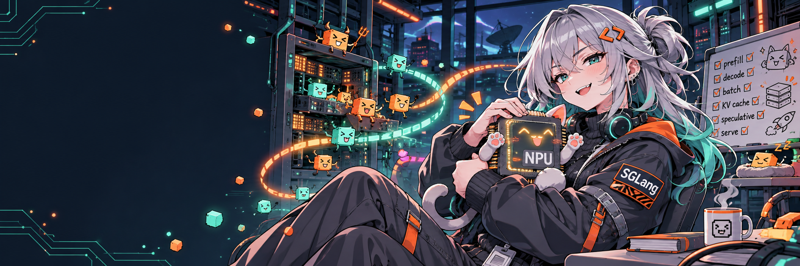
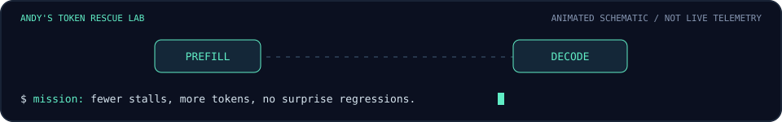

<p align="center">
  
</p>

<h1 align="center">AndyLi429</h1>

<p align="center">
  <b>AI Infra Engineer · SGLang Contributor · NPU Token Wrangler</b><br/>
  I help large models run on Ascend NPUs. The tokens have other plans.
</p>

<p align="center">
  <a href="https://github.com/sgl-project/sglang/pulls?q=is%3Apr+author%3AAndyLi429">Pull requests</a> ·
  <a href="https://www.linkedin.com/in/peihan-li-76b995a0/">LinkedIn / Contact</a> ·
  <a href="https://github.com/sgl-project/sglang">SGLang</a>
</p>

<p align="center">
  
</p>

## 🧪 Things I poke until they go faster

| Research direction | Current habitat |
| :--- | :--- |
| **LLM serving & parallelism** | Prefill context parallelism, attention backends, distributed inference |
| **Speculative decoding** | DSpark, MTP, draft selection, sampling and verification |
| **Ascend NPU execution** | DeepSeek / Qwen model enablement, quantization, kernel integration |
| **Runtime correctness** | Hybrid attention state, graph capture / replay, regression tests |

```text
favorite debugging plot twist:
  "the kernel is slow" → "the host is waiting" → "why is this inside every layer?"
```

## 🏆 Boss fights cleared

Selected contributions merged into [SGLang](https://github.com/sgl-project/sglang).

| Boss | What landed | Loot |
| :--- | :--- | :--- |
| 🐉 **DSpark on NPU** | Native sampling and verification integration; NPU row argmax and verify-length scheduler dispatch | [#46278](https://github.com/sgl-project/sglang/pull/46278) · [#47581](https://github.com/sgl-project/sglang/pull/47581) |
| 🛸 **DeepSeek-V4 meets arch35** | Ascend arch35 support across attention, KV cache, quantization, and MoE execution | [#37373](https://github.com/sgl-project/sglang/pull/37373) |
| 🧩 **Long prompts, divided** | Context-parallel standard attention for Qwen3 MoE on Ascend, with combined K/V all-gather | [#21685](https://github.com/sgl-project/sglang/pull/21685) |
| 👻 **The haunted MTP state** | Fixes for graph-mode state indexing, Mamba state tracking, and NPU draft selection | [#27202](https://github.com/sgl-project/sglang/pull/27202) |
| 🔁 **The same work. Every layer.** | Precomputed convolution-state tracking indices once per batch | [#29105](https://github.com/sgl-project/sglang/pull/29105) |
| 🕸️ **Graph replay gremlins** | Focused capture / replay tests, metadata coverage, and a minimal NPU device test | [#40404](https://github.com/sgl-project/sglang/pull/40404) |

<details>
<summary><b>📓 Lab notes — open when the experiment survives</b></summary>

<!-- Add research notes and reproducible experiments here. -->

</details>

## 📬 Contact Me

Working on inference, Ascend kernels, or a suspiciously expensive synchronization?

[LinkedIn](https://www.linkedin.com/in/peihan-li-76b995a0/) · [Email](mailto:lipeihan1994@gmail.com)

<!-- Blog: -->

---

<p align="center">
  <sub>SGLang-chan is an original, unofficial fan mascot concept. The pipeline is an animation, not live telemetry.<br/>
  No tokens were harmed. Some were rejected during verification.</sub>
</p>
